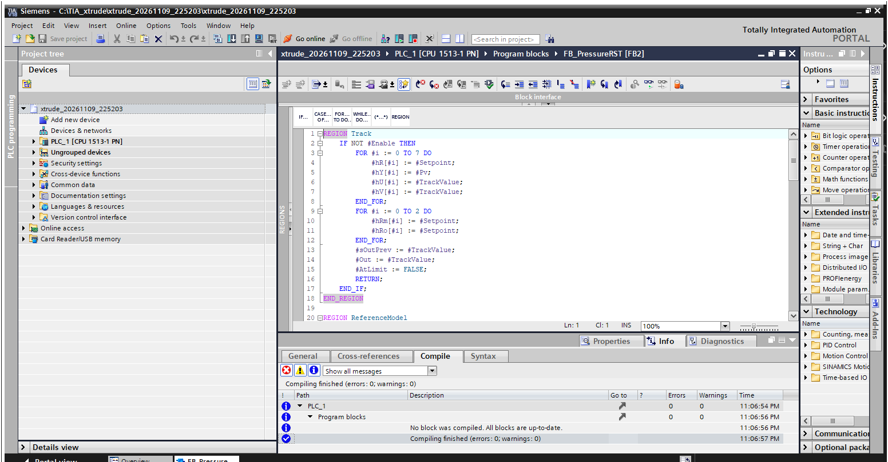

# Model-based head-pressure control and screw-fill estimation for a cold-feed rubber extruder

**Systems engineering dossier.** Pre-baseline draft, revision B, 10 Nov 2026.

**What revision B changed.**
- EKF run-out fix (§13).
- SPS-313 coverage statistic (§11.1).
- Meeting questions (§12).
- Decision log (§14).
- Run-out error bars and the traceability table (`TRACEABILITY.md`).
- The numbers in §0 and §10 are re-run.

This dossier follows the structure of C. S. Wasson, *System Engineering Analysis, Design,
and Development* (2nd ed., Wiley 2016), cited as **[W]** with the printed page and then the PDF page.

The engineering work behind it is in this repository:
- the extruder model, identification, controllers and estimators in `src/xtrude/`;
- the PLC code in `plc/`;
- the study script, `scripts/run_study.py`, which writes `results/study.md`;
- the trade study, `scripts/aoa.py`, which writes `results/aoa.md`.

Every number in this dossier is reproduced by those scripts. Section 8.2 lists which numbers
are **sourced** and which are **assumed**. Reading notes on the Wasson chapters used are in
`docs/sources/`.

> **Status.** Everything is simulation plus a TIA Portal V18 compile. No data from a real
> line has been used. The dossier is a draft for a requirements review. The open items that
> need the plant are collected in section 12 (the TBD register).

---

## 0. Summary of findings

All numbers in this summary are from simulation (§8). The closed-loop figures come from 24
random production scenarios of 1200 s each, using the same scenarios for every alternative
and paired comparisons. Uncertainties are ±2 standard deviations across runs.

1. **What the pressure sits in front of decides what "pressure control" can do (§8.3).**
   - **Open power-law die:** the steady-state gain from speed to pressure is close to zero
     and its sign is uncertain. Viscous heating cancels the flow increase.
   - **Gear pump (the primary case):** the plant is lag-dominated with a slow pole at about
     11 s. Its gain spans **6.7–110 bar/rpm** across operating pressures of 40–80 bar.
     Compound viscosity hardly changes the gain, because a stiffer batch heats itself and thins.
2. **A model-based RST controller does not regulate better than a robustly tuned PID.** Both
   were tuned on the same 10 plant variants under the same constraints (§10.1).
   - **Disturbance rejection:** worst-case IAE after a feed-loss step is **8.25 (RST) vs
     8.83 (PID)**.
   - **Nonlinear Monte Carlo:** the 99th-percentile pressure deviation is **1.09 vs 1.05 bar**.
     RST is better in only 7 of 24 runs.
   - **What the RST does give:**
     - more robustness margin: worst Ms **1.46 vs 1.60**;
     - **12.7 % less speed travel**, better in all 24 runs;
     - **zero overshoot** on a 4-bar setpoint step, against **1.66 bar** for the PID.

     A PID with a setpoint prefilter also reaches zero overshoot.
   - **What limits both:** the 0.5 Hz flight-passing pressure ripple. Allowing 0.2 rpm of
     speed ripple instead of 0.1 rpm halves the IAE of both controllers. A speed-tracking
     notch makes both worse, because the ripple sits only 3–5 times above crossover.
   - **MPC (DMC with an output-disturbance model):** **43 % worse** at the 99th percentile.
     This is the known DMC limit for input disturbances on lag-dominated plants [C6].
3. **The measurable gain comes from topic 3.** Feed changes reach the pressure about 35 s
   after they reach the feed, and the drive torque sees them first. The fill estimator turns
   that into a feedforward speed. Results, paired against the same scenarios:

   | Measure | PID+FF vs PID | RST+FF vs RST |
   |---|---|---|
   | 99th-percentile deviation | **−28 %** median (1.05 → 0.78 bar), better in 21/24 runs | **−22 %**, better in 23/24 runs |
   | Pressure standard deviation | −15 %, better in 23/24 runs | +4 %, better in 8/24 runs |
   | Time outside ±3 bar | 0.31 → 0.17 % | 0.31 → 0.29 % |
   | Actuator travel | +15 % | +17 % |

4. **Compound left in the screw (topic 3), feasibility.** RMSE is over a content of about 8 kg.

   | Estimator | In range | Viscosity outside training range |
   |---|---|---|
   | Physics EKF (torque + head pressure + batch-change events) | **0.093 ± 0.025 kg** (1.2 %), worst run 0.12 kg | **0.145 kg**, worst 0.21 kg |
   | Physics EKF, no batch events | 0.31 kg | — |
   | **Learned model on torque, power and rpm only** (the literal topic) | **0.29 ± 0.26 kg** (MLP) | 0.38 kg |
   | Learned model, all signals | 0.090 kg | 0.144 kg |
   | Static speed/gear-pump mass balance | 0.43 kg | 0.47 kg |

   - **Batch events:** without them the EKF error rises to 0.31 kg, because a viscosity
     change is then misread as a feed change.
   - **Learned models need labels.** Their training targets were the simulator's true mass.
     On a real line every label is a weighed purge, while the EKF needs none.
   - **Static mass balance:** it fails in run-out, with an error of 3.6 kg at the starvation point.

   **Verdict.** Estimating the screw content is **feasible**. From torque, power and rpm alone,
   a learned model reaches about ±0.5 kg (2σ), only within the trained compound range, and only
   once labelled purges exist. The recommended route is the physics EKF using the head pressure
   the loop already measures. It is the most accurate and robust option that needs no labels.

   **Run-out (revision B).** At the starvation point the screw still holds 0.20–0.35 kg.
   - **Accuracy:** the EKF error there is **+0.013 ± 0.029 kg** (mean ± 2σ over 12 run-outs;
     max |error| 0.035 kg; `docs/img/runout_errors.png`), and SPS-312 is met. Revision A was +0.33 to +0.62 kg. The cause was first-order transport smearing the
     emptying front; superbee TVD transport fixed it (§13).
   - **Uncertainty:** the reported ±2σ band contains the truth **99.9 %** of the time in range
     (worst run 98.9 %) and 97.7 % out of range (worst 91.4 %). The uncertainty is
     conservative, not over-confident.
5. **Fits the PLC.** The worst-case added execution is **1.46 ms per 100 ms cycle** at datasheet
   instruction times. The EKF filter call is 1.42 ms. With a 3× margin this is 4.39 ms, within
   the 5 ms allocation (§7.1).
   - All four SCL blocks compile in TIA Portal V18 with **0 errors, 0 warnings**.
   - They match the Python references in float32.
   - Float32 broke the RST's static-gain identity and caused an offset of several bar. The
     SCL now enforces T(1) = R(1) and S(1) = 0 in its code structure (§9, F10).
6. **Recommendation (§10.3).**
   - Build the fill estimator and its early feed-loss warning.
   - Re-identify and robustly retune the existing PID, adding a setpoint filter.
   - Offer the estimator feedforward and the RST as line-trial candidates (VT-04, VT-05).
   - The line trial, not this model, decides whether the RST's margin and wear advantages are
     worth its maintenance cost.

---

## 1. Problem and stakeholders  ([W] ch. 4–5)

### 1.1 Problem statement

The problem statement follows the guidelines in [W] p.92/122: one sentence, no cause, no
solution, no blame.

> During start-up, compound changes and steady production on the cold-feed extruder line,
> the pressure in front of the outlet pump drifts outside its working window. This produces
> extrudate that is off gauge or has to be purged as scrap.

**Discussion.** This is kept separate from the statement itself, as the guidelines require.

The fair topic is phrased as a solution: "replace the current PID … by polynomial or matrix
control" (topic 2), plus "predict the material left in the screws with NN/AI" (topic 3).
[W] warns that stakeholders often state a need as a solution (p.103/133), and recommends the
Five Whys (p.104–105).

Applied to topic 2, the Five Whys run as follows:
1. **Why replace the PID?** Because the pressure is not held well enough.
2. **Why does that matter?** Pressure in front of a gear pump decides how well the pump fills.
   That fill sets the output per revolution, and the output sets the gauge.
3. **Why is it not held?** Mainly because of disturbances in the feed strip, and a feedback
   controller sees them only after they have travelled down the screw.
4. **Why does that matter for the choice of controller?** Section 10 shows that a better
   *feedback* law buys little. The lever is *information about the feed earlier*.
5. **Where does that information come from?** From the screw-fill estimator, which is topic 3.

**This is why the two topics are one project.** The quantity topic 3 wants, the compound in
the screw, is also the state that topic 2 needs as a measured disturbance.

### 1.2 Stakeholders  ([W] Table 4.2, p.84–85/114–115)

| Role ([W] Table 4.2) | Who on the line | What they need from this system |
|---|---|---|
| User / End user | extruder operator | Stable pressure without retuning. Fewer alarms. A clear mode display. The screw content shown during run-out. |
| System owner | production / process engineering | Less scrap per shift. Less start-up waste. Smaller gauge spread. |
| Maintainer | automation / maintenance engineers | Code they can read in TIA Portal. Re-tuning from a short test. A clear response to sensor faults. |
| Customer's customer ([W] P4.3, p.78) | tyre building / quality | Constant extrudate weight per metre. |
| Developer | thesis student + supervisor | A design that can be verified and validated within the thesis. |
| Independent test agent ([W] P13.15, p.289/319) | the plant's process engineer on the line trial | Acceptance against the measures of effectiveness (MOEs), independent of the developer. |

### 1.3 Needs, measures of effectiveness and measures of performance  ([W] p.100–101/130–131, Fig. 5.8 p.116/146)

| ID | Need (stakeholder language) | MOE / MOS | Contributing MOPs (section 5) |
|---|---|---|---|
| N1 | Less off-gauge scrap in steady production | MOE-1: off-gauge scrap kg per shift | SPS-301, SPS-302, SPS-305 |
| N2 | Less waste at start-up and at compound changes | MOE-2: kg purged per start / per change | SPS-304, SPS-311, SPS-312 |
| N3 | Smaller gauge (weight-per-metre) spread | MOE-3: output standard deviation, % | SPS-301, SPS-303 |
| N4 | Know how much compound is left in the screw | MOE-4: purge mass predicted vs weighed, kg | SPS-311, SPS-312, SPS-313 |
| N5 | No new failure modes and nothing hard to maintain | MOS-1: hours of automatic mode lost to the new functions; MOS-2: re-tune time | SPS-321…323, SPS-364 |

[W] says each MOE needs two or more MOPs (p.438/468). The table meets that rule.

---

## 2. Concept of operations  ([W] ch. 6)

The structure follows Table 6.1, the ConOps outline in [W] p.140/170.

### 2.1 Mission and context

**What the line does.** A cold-feed rubber extruder takes in a strip of compound through a
feed roll. Its screw conveys the compound and heats it by shear. A gear pump at the screw tip
meters the compound into the die. The extrudate is taken off at line speed.

**What this system adds.** It sits in the line PLC (S7-1500, TIA Portal) and has three jobs:
1. Hold the pressure at the gear-pump inlet by setting the screw speed.
2. Estimate the compound in the screw and show it.
3. Fall back safely when a sensor fails.

**What it does not do.** It does not replace the line's safety functions: the burst disc,
the hard-wired overpressure switch and the emergency stop.

**Context.** The interfaces are listed in section 6.

| Signal | Direction | Interface |
|---|---|---|
| Head-pressure transducer | In | IF-01 |
| Drive speed and torque | In | IF-02 (PROFINET telegram) |
| Speed setpoint to the drive | Out | IF-02 (PROFINET telegram) |
| Melt thermocouple | In | IF-03 |
| Operator commands | In | IF-04 (HMI) |
| Operator display | Out | IF-04 (HMI) |
| Gear-pump speed and feed status | In | IF-05 (line) |
| Batch-change event | In | IF-06 (line production records) |

### 2.2 Phases and use cases  ([W] P5.7 p.110/140; UC principles p.120–122/150–152; Table 6.4 p.143/173)

| Phase | Use case (verb + outcome) | Trigger | Main success scenario | Alternate / failure scenarios |
|---|---|---|---|---|
| Pre-mission | **UC1** Identify the pressure dynamics | New compound family, new die, or maintenance | Technician runs the 2-minute ±0.3 rpm test. The tool fits a model and proposes RST/PID parameters. | Fit below 50 % → repeat the test. Model outside the robustness set → keep the old parameters. |
| Pre-mission | **UC2** Start up the line | Operator selects Auto after feed-on | The pressure reaches the window. The estimator converges (σ of mass < 0.3 kg). Mode RST+FF is enabled. | Estimator not converged → RST without FF. |
| Mission | **UC3** Hold pressure in production | Continuous | Pressure is held within ±3 bar despite feed and temperature variation. | Feed strip breaks → early warning from torque, then low-pressure alarm. |
| Mission | **UC4** Change compound batch | Line production records report a new batch entering the feed | The estimator frees its viscosity state for one screw transit. FF stays on. | No batch event → the viscosity change is misread as a feed change (quantified in section 9). |
| Post-mission | **UC5** Run out at end of campaign | Feed stopped, screw kept turning | The HMI shows the compound left in the screw. The operator stops when the screw is empty enough. | Pressure falls below the gear-pump fill limit → the gear pump starves. That is the point the estimate must be good at. |
| Any | **UC6** Recover from a sensor fault | Supervisor detects a fault | Speed is held or FF is disabled. An alarm is raised and acknowledged. | Repeated faults → maintenance call (section 9). |

**Coverage check.** [W] Fig. 6.3 (p.137–138) is a matrix of operations against phases.
Here it reduces to this: UC1 is maintenance-only, UC2–UC4 are production, and UC5 is
post-mission. The "Conduct Mission only" gap of Author's Note 6.1 (p.137/167) is closed by
UC1, UC5 and UC6.

---

## 3. Modes and states  ([W] ch. 7)

Definitions are from [W] p.148–149/178–179. A **mode** is a user-selectable label that
enables a set of capabilities. A **state** is an observable, measurable condition.

**Table 3-1: modes.** These are implemented in `FB_PressureSupervisor`.

| # | Mode | Enabled capabilities | Selected by | Exit criteria ([W] Author's Note 7.4: define the current mode's exit criteria) |
|---|---|---|---|---|
| 0 | Manual | Operator speed. Estimator runs and displays. | Operator | Operator selects 1–3 |
| 1 | PID | Baseline loop | Operator | Operator change, PFault → 4, OverPressure → 5 |
| 2 | RST | Model-based loop | Operator, or automatic fallback from 3 | Same as 1 |
| 3 | RST+FF | Model-based loop + fill feedforward | Operator | TorqueFault or estimator invalid → 2; PFault → 4; OverPressure → 5 |
| 4 | SpeedHold (degraded) | Last good speed held | Automatic | Fault cleared **and** acknowledged → requested mode |
| 5 | SafeStop (emergency) | Speed ramped to minimum | Automatic | Pressure below trip **and** acknowledged |

**State variables** ([W] P7.2–7.3, p.154–156):
- **Operational state:** mode number, fault latches, estimator valid.
- **Dynamic state** ([W] P7.9, p.166/196): "batch in transit", the timer set by the batch
  event; and "run-out", with the feed off.

**Allowable and prohibited actions** ([W] P7.10 p.169/199, Fig. 7.14 p.171/201):
- Prohibited: entering 3 while the torque signal is invalid; entering 1–3 while PFault is latched.
- Not advisable: the identification test (UC1) during run-out.
- All transitions are bumpless. Controllers that are not selected track the applied speed.
  This is verified in `tests/test_scl.py` and requirement SPS-306.

---

## 4. Requirements  ([W] ch. 19–22)

The outline follows [W] Table 20.1 (p.417–418/447–448). Section 3.0 of the outline is the
global requirement ([W] P22.2, p.448): the system shall meet these requirements before,
during and after exposure to the operating conditions of §3.5.

Statements follow [W] P22.5 (p.449), one capability and one outcome each ([W] P22.9 p.451).
They are labelled Threshold or Objective ([W] p.410/440). The verification methods are
I, A, D and T ([W] p.270–272).

**Provisional values.** Some values are marked **(P)**. Each traces to an analysis in this
repository ([W] P19.14, p.402/432) but has not been measured on the line. They are carried
as TBR in the TBD register in section 12. [W] p.426/456 warns that a value backed by no
analysis is not a requirement. Each provisional value names the analysis behind it.

### 4.1 Missions and operational performance (§3.1–3.2)

| ID | Requirement | Threshold | Objective | Verif. | Trace |
|---|---|---|---|---|---|
| SPS-201 | With the new control functions enabled, the line shall produce no more off-gauge scrap per shift than with the current controller. | ≤ baseline | ≤ 0.7 × baseline (TBD-1) | T (line trial, section 11) | MOE-1 |
| SPS-202 | Start-up waste per start shall not exceed the current value. | ≤ baseline | ≤ 0.8 × baseline (TBD-2) | T | MOE-2 |
| SPS-203 | The automatic modes (1–3) shall be available for at least the stated fraction of production time, excluding line stops. | ≥ 99 % | ≥ 99.8 % | A + T | MOS-1 |

### 4.2 Capabilities (§3.3)

| ID | Requirement | Threshold | Objective | Verif. | Trace |
|---|---|---|---|---|---|
| SPS-301 | In mode 3 during production with feed-efficiency changes up to ±8 %, the controller shall keep the head pressure within ±3 bar of setpoint. | ≥ 99 % of time (P) | ≥ 99.9 % (P) | A (MC, §8) + T | N1, N3 |
| SPS-302 | After a step feed loss equivalent to 1 rpm, the peak pressure deviation shall not exceed the stated value on every plant variant of §8.4. | 3.5 bar (P) | 2.5 bar (P) | A | N1 |
| SPS-303 | The loop shall keep a maximum sensitivity Ms ≤ 1.6 (modulus margin ≥ 0.625) on every plant variant of §8.4. | 1.6 | 1.5 | A | N3 |
| SPS-304 | On a 4 bar setpoint step, the pressure shall settle within ±0.5 bar in ≤ 20 s with an overshoot ≤ 1 bar. | 20 s | 12 s | A + T | N2 |
| SPS-305 | Speed ripple caused by the 1 % flight-passing pressure ripple shall not exceed 0.1 rpm amplitude. RMS speed noise from the pressure noise shall not exceed 0.1 rpm. | 0.1 rpm | 0.05 rpm | A + T | N1, N5 |
| SPS-306 | A mode change shall not step the speed setpoint by more than 0.2 rpm. | 0.2 rpm | 0.05 rpm | T (SCL test) + D | N5 |
| SPS-311 | In production, the estimate of the compound mass in the pumping section shall have an RMS error no larger than the stated value. | 0.3 kg (≈ 4 %) (P) | 0.15 kg (P) | A + T | N4 |
| SPS-312 | During run-out, at the moment the head pressure first falls below 25 bar, the estimate error shall not exceed the stated value. | 0.5 kg (P) | 0.25 kg (P) | A + T | N2, N4 |
| SPS-313 | The estimator shall report a 1-σ uncertainty with every estimate. | reported | — | I + A | N4 |
| SPS-321 | On a pressure-signal fault (channel status, out of range, or frozen for 20 s while the speed moves), the system shall switch to SpeedHold within one 100 ms cycle and raise a latched alarm. | 100 ms | — | T | N5 |
| SPS-322 | On a torque-signal fault or an invalid estimator, the system shall disable feedforward within one cycle. | 100 ms | — | T | N5 |
| SPS-323 | At head pressure ≥ the trip value, the system shall ramp the speed down at ≥ 5 rpm/s and latch an alarm. This is an operational function, not a safety function (§9). | 5 rpm/s | — | T | N5 |

### 4.3 Interfaces (§3.4)

Only external interfaces are specified here ([W] p.420/450). The details are in the interface
table in section 6.2 (IF-01 … IF-06).

### 4.4 Operating environment (§3.5)

The requirements apply across this range:

| Parameter | Range | Notes |
|---|---|---|
| Screw speed | 15–45 rpm | |
| Inlet pressure setpoint | 40–80 bar | |
| Compound viscosity factor κ | 0.8–1.25 | Relative to the reference batch |
| Melt temperature | 100–140 °C | |
| Pressure transducer noise | 0.3 bar RMS | Specified in TBD-5 |
| Flight ripple | 1 % | Specified in TBD-5 |

### 4.5 Design and construction constraints (§3.6)

| ID | Constraint | Verif. |
|---|---|---|
| SPS-361 | The added functions shall run in a cyclic-interrupt OB at 100 ms on an S7-1513-class CPU. Their worst-case execution shall be ≤ 5 ms, including the margin of §7.1. | A (§7.1) + T (on-target cycle statistics) |
| SPS-362 | The code shall be SCL in TIA Portal V18 and compile with 0 errors and 0 warnings. No third-party libraries. | I + T (done, §11.2) |
| SPS-363 | The functions shall use only signals already on the line: IF-01 … IF-06. No new sensors. | I |
| SPS-364 | Re-identification shall need ≤ 2 min of line time at ≤ ±0.3 rpm speed excitation, during production. | D |

---

## 5. Architecture  ([W] ch. 26)

[W] p.551–552/581–582 uses four views: requirements, operations, behavioural and physical.
"Logical architecture" is not Wasson's term; the behavioural view below plays that role.

**Behavioural view.** These are capabilities, not boxes ([W] P26.15, p.559/589).

```
             IF-06 batch event      IF-05 gear-pump speed, feed on
                    |                         |
 IF-02 torque,N --> [B1 Estimate screw fill] --+--> fill profile, theta, mass, sigma --> IF-04 HMI
 IF-01 pressure --> [B1]                       |
 IF-03 melt T  ---> [B1]                       v
                                      [B2 Compute feedforward speed]
                                                   |
 IF-01 pressure --> [B3 Regulate pressure (RST | PID)] <--+
                                   |
                       [B4 Supervise: modes, plausibility, fallback] --> IF-02 speed setpoint
                                   ^
 IF-04 operator mode request ------+
```

**Physical view.** Each capability maps one-to-one to an SCL block. This keeps the
traceability of [W] P21.2 (p.437/467): every leaf requirement is allocated to one entity.

| Capability | SCL block | Requirements allocated |
|---|---|---|
| B1, B2 | `FB_FillEKF` (estimator + `SpeedBalance` output) | SPS-311…313 |
| B3 | `FB_PressureRST`, `FB_PressurePID` | SPS-301…306 |
| B4 | `FB_PressureSupervisor` | SPS-306, SPS-321…323 |
| Wiring | OB30 `Cyclic_Pressure` + `FC_LoadParams` + `LineIO` DB | SPS-361 |

**Hardware.** CPU 1513-1 PN (6ES7513-1AL02-0AB0, FW 2.9) as the reference target. The line
PLC may be larger, which only adds margin.

**Fault isolation and containment** ([W] P26.16, p.559–560/589–590). A fault in B1 cannot
reach the drive except through B2's feedforward, and B4 removes that path (SPS-322). A
pressure fault removes B3 (SPS-321). There is deliberately no redundant transducer:
[W] p.567 warns that redundancy through a shared connection is cancelled, and the plant
already has a hard-wired overpressure protection layer.

---

## 6. Interfaces  ([W] ch. 27)

### 6.1 Ownership

The line PLC owns all interfaces ([W] P27.3, p.577/607). This project uses one system
interface control document (ICD), which [W] p.582 advises for small projects. That ICD is the
table below. Mnemonics follow [W] P27.6 (p.583).

### 6.2 Interface table

| ID | Source → destination | Signal | Type / range | Rate | Integrity / fault handling |
|---|---|---|---|---|---|
| IF-01 | Pressure transducer → AI card → PLC | Head pressure | 4–20 mA, 0–500 bar (TBD-5) | Read every OB30 call | Channel status bit, range check, frozen-signal detection (SPS-321) |
| IF-02 | Drive ↔ PLC (PROFINET telegram) | Speed setpoint out; actual speed and torque in | rpm; N·m | ≤ 100 ms | Telegram valid bit; torque plausibility 0…1.5 × rated |
| IF-03 | Melt thermocouple → PLC | Melt temperature | °C | 100 ms (sensor lag ~s) | Range check (TBD-6) |
| IF-04 | HMI ↔ PLC | Mode request, acknowledge, setpoint; active mode, mass, σ, alarms | Int / Real / Bool | HMI cycle | — |
| IF-05 | Line PLC → PLC | Gear-pump speed (relative), feed-roll running | Real, Bool | 100 ms | Plausibility vs line speed |
| IF-06 | Line production records → PLC | Batch-change event (new batch at the feed) | Bool, one cycle | Event | If missing: FF continues but section 9 quantifies the error. Treated as a dependency risk. |

**Timing (step 7 of [W] p.583/613).** One OB30 call reads all inputs and writes the speed
setpoint. The drive's speed loop is outside this system; its time constant enters the plant
model as 0.3 s, with a variant at 0.6 s.

---

## 7. Performance budgets and margins  ([W] ch. 31)

### 7.1 PLC cycle-time budget  ([W] P31.4 apportionment, p.668; §31.4 frame-based systems, p.679/709)

The operations come from running the SCL through the translator with operation counters
(`src/xtrude/scl.py`). They are costed at the datasheet times of the CPU 1513-1 PN [P1]:
256 ns per Real operation, 64 ns per integer operation, 48 ns per move, and 20 × 256 ns per
EXP or LN (assumed).

| Allocation in the 100 ms OB30 frame | Count-based estimate | Allocated (estimate × 3 margin, [W] p.669) |
|---|---|---|
| FB_FillEKF v0.2 (filter call, every 5th cycle: 3256 Real ops, 6690 integer/loop, 2622 moves, 5 EXP/LN) | 1416 µs | 4.25 ms |
| FB_PressureRST (103 Real ops) | 35 µs | 0.11 ms |
| FB_PressurePID (runs instead of RST) | 9 µs | — |
| FB_PressureSupervisor | 3 µs | 0.01 ms |
| **Total of the new functions** | 1464 µs (1.5 % of the cycle) | **4.39 ms ≤ 5 ms (SPS-361)** |

**How revision B stayed inside the budget.**
- **The overrun.** The superbee transport first pushed the margined total to 5.08 ms, 2 % over
  the allocation. [W] P31.2 (p.667) asks for a risk threshold that triggers mitigation; this
  was it.
- **Two changes brought it back to 4.39 ms**, without changing the filter result
  (`test_ekf_scl_matches_reference` still passes):
  - only the upper triangle of the symmetric F P Fᵀ is computed;
  - the mass σ uses a precomputed weight vector instead of a branchy 15 × 15 loop.
- **Remaining reserve.** If the on-target measurement (VT-07) still exceeds the allocation,
  the covariance update can be spread over the 4 idle calls between filter steps.
| Reserve kept at system level ([W] Fig. 31.1, p.670/700) | | ≥ 95 ms for the rest of the line program |

**Why a 3× margin.** The datasheet figures are typical times for simple instructions. Indexed
access into optimized DBs and FB-call overhead are not in them. [W] p.669 gives 2–3× as the
usual engineering margin. **Verification:** read the OB30 execution time from the CPU's cycle
statistics during the line trial (§11, VT-07). This budget is a TPM ([W] P21.4, p.442/472):
the prediction now becomes the measured value on the target.

### 7.2 Pressure → gauge error budget  ([W] P31.5 synthesis by model, p.669/699)

The gear pump's fill curve couples the inlet pressure to the output. Under the assumed fill
curve, Q ∝ 1 − e^(−P/15 bar), the sensitivity at 60 bar is about 0.12 % of output per bar
(TBD-4).

| Contributor | 1σ at the pressure | → output (gauge) |
|---|---|---|
| Closed-loop pressure deviation (PID 0.45, PID+FF 0.38, RST 0.46, RST+FF 0.49 bar std; Monte Carlo) | 0.38–0.49 bar | 0.045–0.058 % (simulated output std) |
| Transducer accuracy (TBD-5, e.g. ±0.5 % FS of 500 bar = 2.5 bar, *static* offset) | shifts the operating point, not the spread | ≈ 0.3 % static shift, removed by the weight-per-metre trim |
| Speed ripple from flight ripple (SPS-305) | ≤ 0.1 rpm → < 0.2 bar | < 0.03 % |

**Conclusion.** In this configuration the pressure loop contributes at most about 0.1 % to
gauge spread. Most of its value is in keeping the gear pump out of starvation, where
efficiency collapses below about 25 bar, and away from overpressure. This is why SPS-301 is
written as a *window* requirement and not as a variance requirement.

### 7.3 Estimator error budget

| Contributor | Effect on mass estimate |
|---|---|
| Unknown viscosity of a new batch (no batch event) | RMSE rises from 0.09 to 0.31 kg (§9, F7) |
| Rheology mismatch (estimator n, b vs truth: 0.25/0.010 vs 0.2226/0.0089) | absorbed by θ in steady state; transient error inside the SPS-311 figure |
| Gear-pump fill-curve error (+10 % P_fill) | biases the steady-state fill; inside the SPS-311 figure |
| Reduced resolution (12 vs 80 compartments) | with first-order transport it smeared the run-out front (+0.43 kg mean error at the starvation point, rev. A). The TVD transport of rev. B removes most of it (§13). |

---

## 8. Modelling and simulation  ([W] ch. 33)

### 8.1 Intended use and fidelity  ([W] P33.1, p.706/736; fidelity matrix, p.708/738)

**Intended use.** The model is used for three things:
1. to compare controller and estimator *alternatives* under the same disturbances;
2. to size the PLC budget;
3. to produce provisional MOP values.

It is **not** accredited to predict absolute pressures or masses on the real line.
[W] p.704 defines accreditation as acceptance *for a specific purpose*; that purpose is the
comparison only. Before any absolute number is trusted, the model must be validated with line
data (§11, VT-01 and VT-02). [W] P33.4 (p.716/746): a model is only as valid as its
validation.

| Phenomenon | Fidelity here | Source / basis |
|---|---|---|
| Drag and pressure flow in the channel | Newtonian flat-plate with shape factors, power-law viscosity at the channel shear rate | [S1] ch. 7, [S2] §6.3 |
| Partially filled (starved) screw, moving fill front | 1-D advection of fill, fill-front mass balance | [S4], [S2] ch. 9 |
| Rheology | Power law + exponential temperature shift | [S7] n, b, T0; K scaled (§8.2) |
| Viscous heating | Barrel-wall work, one lumped temperature node | [S2] §6.3 power; lumped node assumed |
| Head / outlet | Compressible head volume; gear pump with fill curve, or power-law die | [S8] eq. 1 form for the die; gear-pump curve assumed |
| Drive | First order 0.3 s + 5 rpm/s ramp | assumed |
| Batch viscosity | Carried with the compound | assumed (physical) |
| Sensors | 0.3 bar noise, 0.1 bar resolution, 1 % flight ripple; torque noise 0.5 % rated | assumed; ripple at screw frequency per [S8] (pressure oscillation observed) |
| Wall slip, yield stress, die swell, cure | **not modelled** | [S3], [S4] report slip / yield for rubber: a known gap |

### 8.2 Sourced vs assumed parameters

| Parameter | Value | Status |
|---|---|---|
| Power-law index n | 0.2226 | **sourced** [S7] |
| Temperature coefficient b | 0.0089 /K, T0 = 90 °C | **sourced** [S7] |
| Consistency K | 0.988e6 × 0.4 Pa·sⁿ | **sourced × assumed scale**. The scale of 0.4 makes nominal torque 65 % of the rating of the vendor drive class [S5]. Units are assumed SI. |
| Screw D, speed range, drive power | 150 mm, ≤ 45 rpm, 185 kW | **sourced** (vendor class) [S5] |
| Lead, depth, flight width, clearance, pumping length | 150, 18, 15, 0.5 mm; 1.2 m | **assumed** |
| Heat transfer UA | 1100 W/K | **assumed**, calibrated to about 120 °C at the design point |
| Head volume, effective bulk modulus | 4 L, 0.5 GPa | **assumed** |
| Gear-pump fill pressure | 15 bar | **assumed (TBD-4)** |
| Fill at the feed opening | 0.75 of drag capacity | **assumed** |
| Disturbance magnitudes | feed ±8 %, κ 0.8–1.25, line speed ±10 %, barrel ±5 K | **assumed (TBD-3)** |

**Plausibility checks** (results/study.md §1):
- Design point: 741 kg/h at 30 rpm. At 45 rpm the model gives 1111 kg/h, against the vendor
  class's 1100 kg/h at maximum speed [S5].
- Specific energy 0.119 kWh/kg. The published range for a 40 mm rubber extruder is
  0.3–1.7 kWh/kg [S6], and large machines sit lower.
- Torque 66 % of rated.
- Melt temperature 120 °C (103–132 °C over 15–45 rpm).

### 8.3 Why the outlet type matters (finding)

The fair topic does not say what the pressure sits in front of. `docs/img/outlet_step_response.png`
compares the two outlet types:

- **Power-law die.** A 10 % speed step raises pressure by only about 2.5 bar. The extra
  viscous heat then lowers the die viscosity, and the pressure ends *below* its start. The
  steady-state gain is close to zero and its sign is uncertain. A pressure loop on an open die
  regulates the wrong variable for gauge.
- **Gear pump (the primary case here).** The same step raises the pressure steadily. The
  plant is lag-dominated with a slow pole near 10 s, and its gain varies about 16× with the
  operating pressure (§8.4).

**Open question.** Which configuration the plant has is open question Q1 (§12).

### 8.4 Plant variants (uncertainty set for design)

The variants are noise-free small-signal models identified at:
- nominal;
- κ 0.7 and 1.3;
- 40 and 80 bar;
- 20 and 40 rpm;
- bulk modulus 0.25 and 1.0 GPa;
- drive time constant 0.6 s.

DC gains range from 6.7 (at 40 bar) to 110 (at 80 bar) bar/rpm. The operating pressure dominates, through
the gear-pump fill curve. Viscosity hardly matters (27.5 bar/rpm at κ = 0.7, 1.0 and 1.3),
because a stiffer batch heats more and thins itself.

---

## 9. Reliability, failure modes and the FMEA  ([W] ch. 34)

### 9.1 What counts as a failure

[W] P34.3 (p.729/759) asks that this be defined and agreed with the stakeholders. **A failure
of the new functions** is any of these:
- the head pressure leaves ±5 bar of setpoint for more than 10 s while in an automatic mode,
  with no line disturbance outside §4.4;
- a mass estimate is outside its own ±3σ for more than 60 s;
- an automatic mode is lost for a reason other than a detected sensor fault.

Drift counts as a failure ([W] p.728).

### 9.2 FMEA

The FMEA takes its columns from [W] Fig. 34.20 (p.766/796). Each row is scored for severity
S, occurrence O and detection D, each from 1 to 10. The risk priority number is
RPN = S × O × D, after Dhillon ([W] Eq. 34.41, p.765/795). Occurrence values are engineering
estimates (TBD-7). [W] P34.12 (p.740/770): RMA figures are estimates.

| ID | Item / function | Failure mode | Local effect | End effect | Detection | Compensating provision | S | O | D | RPN |
|---|---|---|---|---|---|---|---|---|---|---|
| F1 | Pressure transducer (IF-01) | Wire break / channel fault | Pv invalid | Wrong speed → starve or overpressure | AI channel status | SpeedHold + alarm (SPS-321) | 8 | 3 | 1 | 24 |
| F2 | Pressure transducer | Frozen signal | Loop open | Pressure drifts unseen | No change for 20 s while speed moves | SpeedHold (SPS-321), `test_frozen_pressure_detected` | 8 | 2 | 3 | 48 |
| F3 | Pressure transducer | Slow zero drift (temperature, diaphragm) | Controlled to a wrong pressure | Gear pump fill shifts; gauge shift ≈ 0.12 %/bar | **Not** by plausibility. Zero check at the start of each campaign (screw empty, at temperature). The EKF pressure innovation trend is the condition-monitoring flag ([W] P-F curve, Fig. 34.25 p.787/817). | Recalibration procedure | 5 | 4 | 6 | **120** |
| F4 | Pressure transducer | Noisy / damaged diaphragm | Speed noise | Gauge noise, drive wear | RMS of innovation > limit | Alarm; PID fallback with lower gain | 4 | 2 | 4 | 32 |
| F5 | Drive torque (IF-02) | Telegram loss / implausible | Estimator blind | FF wrong | Telegram valid bit, range | FF off → mode 2 (SPS-322) | 4 | 3 | 1 | 12 |
| F6 | Drive torque | Scaling changed (drive parameter edit) | θ estimate jumps | Mass estimate biased | θ outside the plausible band after transit | Alarm "torque scaling", FF off | 4 | 2 | 5 | 40 |
| F7 | Line records (IF-06) | Batch event missing | Viscosity read as feed change | FF pushes the wrong way during transit | Only afterwards (pressure innovation) | Estimator error quantified (0.31 kg without events vs 0.09 kg with them); request the event as a dependency (Q4) | 5 | 5 | 7 | **175** |
| F8 | Gear-pump speed (IF-05) | Wrong scaling | Wrong balance speed | FF bias | Feedback integrator absorbs it; FF deviation > 3 rpm alarm | FF uses *changes* only (OB30) | 3 | 2 | 4 | 24 |
| F9 | Feed strip | Break / end of strip | Fill falls at the feed | Pressure collapses 30–40 s later | **Early** via torque (EKF), then low-pressure alarm | Operator warning before the pressure drops | 6 | 4 | 2 | 48 |
| F10 | RST parameters | Wrong or corrupt download | Offset or instability | Pressure off target | Startup check that T(1) = R(1) and S(1) = 0 (see note) | Fall back to PID | 7 | 2 | 3 | 42 |
| F11 | OB30 | Cycle overrun | Time error OB80 | Late setpoints | CPU diagnostics | Budget §7.1 (≤ 5 ms of 100 ms) | 6 | 1 | 2 | 12 |
| F12 | Supervisor | Overpressure not caught by software | — | Mechanical damage | Hard-wired switch / burst disc (outside scope) | Independent safety layer | 9 | 1 | 2 | 18 |

**Note on F10.** In float32 the rounded coefficients break both T(1) = R(1) and S(1) = 0,
which causes a static offset of several bar. FB_PressureRST therefore enforces both
identities in its code structure. This is verified by `test_rst_scl_matches_reference_in_closed_loop`.

**Highest RPNs.**
- **F7 (missing batch event).** Measured mitigation: the EKF error without batch events is
  0.31 kg, against 0.09 kg with them.
- **F3 (transducer drift).** Mitigation: a calibration procedure, and the EKF innovation
  trend used for condition-based maintenance.

### 9.3 Availability

SPS-203 asks for the automatic modes to be available at least 99 % of production time. The
inherent availability is Ai = MTBF / (MTBF + MCMT) ([W] Eq. 34.53, p.781/811). It is
dominated by the transducer: F1–F4 are the faults that force SpeedHold. All values below
are TBD-7.

| Quantity | Assumed value | Basis |
|---|---|---|
| Transducer faults forcing SpeedHold (MTBF) | 1 per 2 years ≈ 8000 h | Order of magnitude for melt-pressure transducers in rubber |
| Corrective time (MCMT) | 1 h | Replace and zero the transducer |
| Resulting Ai | ≈ 0.99988 | From the two values above |

The estimate must name its five criteria ([W] p.741/771): operating environment, mission
duration, operating condition, elapsed time and probability of success. This is part of
TBD-7.

---

## 10. Analysis of alternatives  ([W] ch. 32)

The method is the 12 steps of [W] p.689–690/719–720:
- normalised 100-point weights ([W] Fig. 32.8);
- linear utility functions ([W] Fig. 32.9);
- a ±10 % weight sensitivity check ([W] §32.7, p.696/726).

The full arithmetic is in `scripts/aoa.py`, and its output is `results/aoa.md`.

### 10.1 Pressure controller

All candidates were tuned on the same 10-variant set under the same constraints (§4.2:
SPS-303 and SPS-305). The baseline is therefore a *robustly tuned* PID, not a strawman.

The factors and weights come from the stakeholder needs in §1:

| Factor | Weight | Basis |
|---|---|---|
| Regulation | 30 | N1, N3 |
| Robustness | 15 | SPS-303 |
| Degradation behaviour | 10 | N5 |
| PLC load | 10 | SPS-361 |
| Maintainability | 20 | Maintainer, [W] Table 4.2 |
| Implementation risk | 15 | — |

The utilities are linear; the ranges and the reason for each judgement score are written in
`results/aoa.md`.

| Alternative | Regulation (p99) | Robustness (worst Ms) | Degradation | PLC load | Maintainability | Impl. risk | **FOM** |
|---|---|---|---|---|---|---|---|
| PID (robust retune) | 0.98 (1.05 bar) | 0.57 (1.60) | 0.60 | 1.00 | 1.00 | 1.00 | **89.0** |
| PID + fill feedforward | 1.00 (0.78 bar) | 0.57 (1.60) | 0.90 | 0.83 | 0.80 | 0.70 | **82.4** |
| RST | 0.97 (1.09 bar) | 0.76 (1.46) | 0.60 | 0.99 | 0.60 | 0.80 | **80.5** |
| RST + fill feedforward | 1.00 (0.83 bar) | 0.76 (1.46) | 0.90 | 0.83 | 0.50 | 0.60 | **77.8** |
| MPC (DMC) | 0.80 (1.60 bar) | 0.30 (n/a) | 0.60 | 0.75 | 0.30 | 0.40 | **54.0** |

**Sensitivity** ([W] §32.7). No single ±10 % weight change moves the winner.

**Assumption tests** ([W] P32.10). These do not re-score the study; they show what the
ranking depends on.
- **Regulation utility.** The regulation range above, 4 bar → 0 and 1 bar → 1, flattens the
  regulation differences, because every alternative already meets the ±3 bar window. Stretch
  the utility to the observed range, 1.6 bar → 0 and 0.7 bar → 1, and **PID + fill
  feedforward** wins at every regulation weight from 30 to 60.
- **Actuator wear.** Adding a 10-point actuator-wear factor keeps PID first and moves RST to
  second.
- **What decides it.** The choice between PID and PID+FF depends on one stakeholder value: how
  much a ~25 % cut in pressure peaks is worth when gauge spread is already only ~0.05 %. That
  value has to come from the plant (TBD-1, TBD-3).
- **RST does not win under any test.** On this model its advantages are margin, wear and
  setpoint tracking, not regulation.

### 10.2 Fill estimator

The factors and weights:

| Factor | Weight |
|---|---|
| Accuracy in range | 35 |
| Accuracy out of the trained viscosity range | 25 |
| Run-out accuracy | 15 |
| Sensors needed | 10 |
| Explainability to maintenance | 15 |

| Alternative | In range | Out of range | At run-out point | Sensors | Explainability | **FOM** |
|---|---|---|---|---|---|---|
| **Physics EKF** (torque + pressure + batch events) | 0.093 kg | 0.145 kg | 0.02 kg | 0.7 | 0.8 | **87.0** |
| MLP, all signals | 0.090 kg | 0.144 kg | 0.14 kg | 0.7 | 0.2 | **77.7** |
| Ridge, all signals | 0.200 kg | 0.281 kg | 0.84 kg | 0.7 | 0.5 | 61.5 |
| MLP, torque/power/rpm (topic 3 literal) | 0.293 kg | 0.375 kg | 0.13 kg | 1.0 | 0.2 | 57.5 |
| Static mass balance | 0.426 kg | 0.470 kg | 3.61 kg | 1.0 | 1.0 | 42.0 |
| Ridge, torque/power/rpm | 0.370 kg | 0.492 kg | 1.24 kg | 1.0 | 0.5 | 39.8 |

**Sensitivity.** No single ±10 % weight change moves the winner.

**Revision A.** Before the transport fix the EKF scored 81.5 against the MLP's 78.1. Its
run-out error then was 0.43 kg; it is now 0.02 kg.

**What the table does not show: labels.** The MLP on all signals matches the EKF's RMSE, but
its accuracy was bought with training labels the simulator gave for free. On a line, labels
cost one weighed purge each. The plan therefore has three steps:
1. Deploy the EKF.
2. Log weighed purges (VT-02, VT-08).
3. Train a learned *residual* on top of the EKF once enough labels exist, combining the two
   instead of choosing one. This is listed as future work.

### 10.3 Recommendation

1. **Build the screw-fill EKF** (`FB_FillEKF`), together with the batch-change event from
   the line records (IF-06).
   - **First, in observation mode:** it shows the compound in the screw and warns of feed
     loss about 30 s before the pressure drops.
2. **Re-identify and robustly retune the existing pressure PID.** Use the 2-minute ±0.3 rpm
   test of UC1 and the 10-variant tuning of §8.4.
   - **Add a setpoint filter**, so start-up ramps do not overshoot (SPS-304).
   - **Cost and benefit:** cheap, and it removes the dependence on manual tuning.
3. **Offer two candidates in the line trial**, each against the retuned PID (VT-04, VT-05):
   - **PID or RST with fill feedforward:** expected −22 to −28 % at the 99th percentile of the
     pressure deviation, at the price of +15–17 % actuator travel.
   - **RST alone:** expected equal regulation, Ms 1.46 instead of 1.60, −13 % actuator travel.
4. **Let the plant decide on topic 2 from its own data.** This study does not support the
   premise that polynomial control will regulate better than a well-tuned PID on this plant.
   It does show the polynomial design is **implementable, verified in float32 and compiled**,
   and where its real advantages are. Section 12 lists what would change this conclusion:
   - an outlet with more dead time;
   - stronger disturbances than assumed;
   - a die instead of a gear pump.

---

## 11. Verification and validation  ([W] ch. 13, 28)

[W] P13.3 and P13.4 (p.275/305) separate two questions. **Verification** asks whether the
system meets its requirements. **Validation** asks whether it is the right system for the
need. Verification here uses the fewest and cheapest methods that are sufficient
([W] P13.11, p.283/313).

### 11.1 Requirements verification traceability matrix  ([W] Table 22.3, p.458)

| Req. | Method | Evidence so far | Status |
|---|---|---|---|
| SPS-301 | A (MC) + T | results/study.md §4 | A: threshold met by all five (worst 0.31 % of time outside ±3 bar); objective of 99.9 % not met (best PID+FF 99.83 %); T open |
| SPS-302 | A | results/study.md §3 | Threshold met (worst peak PID 2.95, RST 2.91 bar); objective of 2.5 bar not met |
| SPS-303 | A | results/study.md §3 | Met (PID 1.60, RST 1.46; RST meets the 1.5 objective) |
| SPS-304 | A + T | results/study.md §3, 4-bar step columns | RST met (8.0 s, 0 bar); PID alone fails the overshoot (1.66 bar), PID with setpoint filter met (8.4 s, 0 bar); T open |
| SPS-305 | A + T | results/study.md §3 (ripple, noise columns) | A met; T open |
| SPS-306 | T + D | `tests/test_scl.py` (tracking on Enable = FALSE) | T met (SCL); D open (PLCSIM/HMI) |
| SPS-311 | A + T | results/study.md §5 | A: threshold and objective met (EKF mean 0.093 kg, worst run 0.116 kg); T open |
| SPS-312 | A + T | results/study.md §5 run-out table | A: met in all 12 run-outs (−0.02 … +0.04 kg; revision A missed it with up to 0.62 kg, see §13); T open |
| SPS-313 | I + A | `MassSigma` output; results/study.md §5 coverage line | I met. A: truth within ±2σ for 99.9 % of the time in range and 97.7 % out of range (conservative) |
| SPS-321 | T | `test_supervisor_fallbacks`, `test_frozen_pressure_detected` | met (SCL in translator); PLCSIM open |
| SPS-322 | T | `test_supervisor_fallbacks` | met (SCL); PLCSIM open |
| SPS-323 | T | `test_supervisor_fallbacks` | met (SCL); PLCSIM open |
| SPS-361 | A + T | §7.1 budget; on-target cycle statistics | A met (4.39 ms with 3× margin); T open |
| SPS-362 | I + T | results/tia_compile*.txt, docs/img/tia_FB_PressureRST.png | **Met** (9 Nov 2026): 0 errors, 0 warnings for all blocks, OB30 at 100 ms |
| SPS-363 | I | §6 interface table | met |
| SPS-364 | D | `ident.step_test` (120 s, ±0.3 rpm) | A met; D open |

### 11.2 What has been verified in this repository

1. **SCL equivalence (V01).** The SCL that goes into TIA runs in CI through a translator that
   uses float32 Real:
   - PID: matches the reference to 1e-3 rpm;
   - RST: matches to 0.01 rpm in closed loop, with no static offset;
   - EKF: mass matches to 0.02 kg against the float64 reference.

   The translator is the author's own, and covers only the SCL subset used. TIA Portal is the
   authority.
2. **TIA Portal V18 compile (V02).** Done on 9 Nov 2026 through TIA Openness, using
   `scripts/tia_build.ps1` and `tia_ob30.ps1`. It was repeated on 10 Nov for revision B, with
   FB_FillEKF v0.2 (superbee transport and the leaner covariance loops).
   - **Target:** S7-1513-1 PN, FW 2.9.
   - **Compiled with 0 errors and 0 warnings:**
     - FB_PressurePID (FB1), FB_PressureRST (FB2), FB_FillEKF (FB3) and FB_PressureSupervisor (FB4);
     - FC_LoadParams (FC1);
     - the five DBs;
     - `Cyclic_Pressure` as a real OB30 cyclic interrupt at 100 ms.
   - **Evidence:** the logs are `results/tia_compile.txt` and `results/tia_compile_ob30.txt`.
     The screenshots are `docs/img/tia_FB_PressureRST.png` (9 Nov) and
     `docs/img/tia_FB_FillEKF.png` (10 Nov).

   
3. **Not yet: PLCSIM (V03), on-target timing, line trial.**
   - **PLCSIM:** checked on 10 Nov. S7-PLCSIM is not installed for any of the TIA versions on
     this PC (V16, V18, V20). Installing it needs a Siemens Industry Online Support login.
   - **The other two:** on-target timing and the line trial need the plant's hardware.

### 11.3 Line-trial plan (validation)  ([W] P13.13, p.284/314; SITE, ch. 28)

The test environment builds up in stages ([W] Fig. 33.6, p.715): simulated, then PLCSIM with
the plant model as an SCL FB, then the real line in observation mode, then the real line in
closed loop. Integration is incremental, one capability at a time ([W] P28.1, p.605/635).

| Step | Test case (phase → mode → UC, [W] Table 28.2 p.614/644) | Configuration | Acceptance criterion | Verifies |
|---|---|---|---|---|
| VT-01 | Pre-mission → Manual → UC1 | Real line, speed doublet ±0.3 rpm, PLC logs P, N, torque, T at 10 Hz | Fit ≥ 50 % on a second record; poles inside the variant set of §8.4 | Model validity (§8.1) |
| VT-02 | Mission → Manual (estimator only) → UC3 | Observation mode: estimator runs, does not act; one purge weighed at the end | Weighed purge vs estimate within SPS-312 | SPS-311/312 (first evidence) |
| VT-03 | Mission → PID → UC3 | Current PID retuned by the robust method of §8.4 | Baseline numbers for SPS-201/202 | Baseline |
| VT-04 | Mission → RST → UC3 | RST from VT-01's model | SPS-301, SPS-305 vs VT-03 | SPS-301/305 |
| VT-05 | Mission → RST+FF → UC3, UC4 | Batch event wired (IF-06) | SPS-301; no adverse effect at batch changes | SPS-301, F7 |
| VT-06 | Any → faults → UC6 | Disconnect the transducer signal at the AI card in Manual with low speed; simulate a torque telegram loss | SPS-321/322 within one cycle | SPS-321…323 |
| VT-07 | Any | CPU cycle statistics over one shift | OB30 net time ≤ 5 ms | SPS-361 |
| VT-08 | Post-mission → RST+FF → UC5 | Run-out, purge weighed | SPS-312 | SPS-312 |
| VAL-1 | Validation over two weeks | A/B by shift (current vs new) | MOE-1…3 vs baseline | SPS-201/202, N1–N3 |

**Rules for the trial.**
- **Site order.** On site: read the state, take a backup, then make changes. Retests run in
  manual at slow speed first.
- **Independence.** The acceptance test is run by the plant's process engineer, not the
  developer ([W] P28.4, p.608/638; P13.15).
- **Configuration control.** Any change to the PLC code after verification invalidates that
  verification until it is re-run ([W] P13.16, p.289/319).
- **Regression.** Every parameter or code fix gets a regression run of `pytest` plus the
  affected VT steps ([W] p.609/639).

---

## 12. TBD register and open questions

| ID | Item | Needed for | How it gets resolved |
|---|---|---|---|
| Q1 | Outlet type at the pressure sensor: gear pump, roller head, or open die? | Whole design (§8.3) | First meeting. It changes the plant class. |
| Q2 | Current PID: structure, settings, cycle time, saturation and anti-windup method | Baseline (VT-03) | Read from the TIA project |
| Q3 | Signals available: torque in the drive telegram? melt T? gear-pump speed? | SPS-363 | I/O list |
| Q4 | Is there a batch-change event (production records / barcode at the feed)? | F7, SPS-311 | Production IT |
| TBD-1/2 | Baseline scrap and start-up waste | SPS-201/202 | Two weeks of production data |
| TBD-3 | Real disturbance magnitudes (feed, κ spread from mixing-room Mooney data) | §4.4, MOPs marked (P) | Historian + lab data |
| TBD-4 | Gear-pump volumetric-efficiency curve vs inlet pressure | §7.2 | Pump datasheet |
| TBD-5 | Transducer model, range, accuracy, noise | IF-01, §7.2 | Data plate / datasheet |
| TBD-6 | Melt temperature sensor position and lag | IF-03 | Drawing |
| TBD-7 | Failure rates and repair times | §9 | Maintenance records |
| TBD-8 | Compound rheology (n, b, K) for the plant's compounds | §8.2 | Capillary / RPA tests per ASTM D5099 [S9] |

---

## 13. Limits of this work

- **Simulation only.** The model is built from textbook physics and one published compound.
  It is not validated on a line (§8.1).
- **Rubber-specific effects that are left out.** Wall slip and the yield stress of filled
  compounds [S3, S4] are not modelled. Both would change the filled length and the
  torque-to-fill relation.
- **The gear-pump curve is assumed.** The gauge budget (§7.2) depends on it directly.
- **The MPC tested is DMC with an output-disturbance model.** A state-space MPC with an
  input-disturbance model would do better ([C6]) but was not built. The AoA therefore rates
  MPC on what was tested.
- **The learned models were trained on simulated data.** Their out-of-range behaviour (§10.2)
  is the honest feasibility signal. Their in-range accuracy says little about real data.
- **The PLC timing is an estimate** from operation counts and datasheet figures. It is not a
  measurement.
- **Run-out accuracy (fixed in revision B).** Revision A's EKF overestimated the last few
  hundred grams of a run-out by 0.33–0.62 kg, which missed SPS-312.
  - **Diagnosis:** the first-order upwind transport on the 12-compartment grid smeared the
    emptying front over about 8 compartments. The plant's own front was 1–2 compartments wide.
    The filter was also over-confident there (σ ≈ 0.04 kg against a 0.4 kg error).
  - **Fix:** a second-order TVD transport with the superbee limiter (LeVeque 2002, ch. 6), plus
    fill process noise that grows with the local fill step.
  - **Cost:** the state stays at 15. F keeps two non-zeros per row, because the limiter is left
    out of the linearisation. The cost is a few hundred extra operations per filter call.
  - **Result:** see §0 and results/study.md §5. On its own, with four seeds and 92 % feed
    before the run-out, the run-out error fell from 0.38 kg to 0.01–0.02 kg.
- **A simulator defect was found and fixed in revision B.** It concerned the truth model, not
  the estimator.
  - **The bug:** when a run-out emptied the screw, the filled-zone length was clamped at its
    2 mm minimum. That clamp created material, so the screw kept "pumping" and the head held
    about 9 bar with nothing in the screw.
  - **How it showed:** the EKF then invented 0.5–0.7 kg to explain the 9 bar.
  - **The fix:** the screw now delivers only what is available.
    `test_empty_screw_creates_no_material` guards it.
  - **What it affected:** only the tails of the run-outs, after starvation. The controller
    numbers in §0 did not change.
- **Not every disturbance was varied.** The Monte Carlo covers feed, viscosity, line speed and
  barrel temperature. It does not cover transducer drift (F3) or a change of die or gear pump.

---

## 14. Decision log

[W] P32.5 (p.697/727): an undocumented trade study is personal opinion. The same applies to
the smaller decisions. Each one is recorded here with its reason.

| # | Date | Decision | Reason | Alternatives rejected |
|---|---|---|---|---|
| D1 | 9 Nov | Primary plant case: gear-pump inlet pressure; open die kept as the contrast case | With an open die the speed→pressure DC gain is about 0 and its sign is uncertain (§8.3). Pressure control there regulates the wrong variable | Die-only study |
| D2 | 9 Nov | Identification: output error (OE) on a ±0.3 rpm, 2-minute test | ARX was biased under 0.3 bar noise and flight ripple. At ±1 rpm the gear-pump curve makes the plant nonlinear (85 % fit) | ARX; larger excitation |
| D3 | 9 Nov | Tune PID and RST on the same 10-variant set under the same constraints | A fair comparison needs a robust baseline, not a strawman PID | Tuning the RST alone and comparing it with a textbook PID |
| D4 | 9 Nov | No measurement notch | It cost more phase than it saved, because the ripple is only 3–5× above crossover (results §3) | Speed-tracking notch |
| D5 | 9 Nov | MPC tested as DMC (output-disturbance model) only | It is the common industrial form. Its known limitation is reported [C6] instead of building a second MPC | State-space MPC with an input-disturbance model (future work) |
| D6 | 9 Nov | RST in SCL uses a structural form that enforces T(1)=R(1) and S(1)=0 | Float32 rounding of the coefficients caused an offset of several bar | Direct-form sums |
| D7 | 9 Nov | The batch-change event from the line records is an estimator input | Without it, a viscosity change reads as a feed change (RMSE 0.09 → 0.31 kg) | Torque only |
| D8 | 10 Nov | Superbee TVD transport and front-dependent noise in the EKF | First-order upwind missed SPS-312 by up to 0.62 kg. The state count and the sparsity of F are unchanged | A finer grid (O(n²) cost); a dedicated run-out mode |
| D9 | 10 Nov | Fix the simulator so an empty screw delivers only the material that exists | The clamp created mass. The truth model must conserve mass at its limits | Leaving it and documenting it |
| D10 | 10 Nov | Keep the EKF covariance work in one call, made cheaper (symmetric prediction, weighted σ) | 4.39 ms with margin is within budget, and splitting adds latency and complexity | Splitting the update over 5 calls (kept in reserve) |
| D11 | 10 Nov | Recommend a robust PID + setpoint filter + estimator, and trial FF/RST | Trade study §10 and its assumption tests | Replacing the PID with RST outright |
| D12 | 10 Nov | PLCSIM, on-target timing and publishing stay open, recorded in `OPEN_ITEMS.md` | They need a Siemens login and licence, the plant's hardware, or the owner's approval | — |

---

## 15. References

The full list, including the source status of each entry, is in `docs/sources/REFERENCES.md`.
The main entries:

- **[W]** C. S. Wasson, *System Engineering Analysis, Design, and Development*, 2nd ed., Wiley, 2016.
- **[S1]** C. Rauwendaal, *Polymer Extrusion*, 5th ed., Hanser, 2014.
- **[S2]** Z. Tadmor, C. G. Gogos, *Principles of Polymer Processing*, 2nd ed., Wiley, 2006.
- **[S3]** J. L. White, *Rubber Processing*, Hanser, 1995.
- **[S4]** Brzoskowski et al., *Int. Polym. Process.* 2 (1987), doi:10.1515/ipp-1987-0004.
- **[S5]** Vendor data, 150 mm cold-feed extruder class.
- **[S6]** KGK, energy in rubber extrusion.
- **[S7]** Ha et al., KSME 2007 (compound w6043).
- **[S8]** Previdi, Savaresi, Panarotto, IFAC 2005; *Control Eng. Practice* 14 (2006).
- **[S9]** ASTM D5099.
- **[C1]** Åström & Wittenmark, *Computer-Controlled Systems*, 3rd ed., 1997.
- **[C2]** Landau & Zito, *Digital Control Systems*, 2006.
- **[C3]** Bobál et al., *Digital Self-tuning Controllers*, 2005.
- **[C4]** Åström & Hägglund, *Advanced PID Control*, 2006.
- **[C5]** Camacho & Bordons, *Model Predictive Control*, 2007.
- **[C6]** Lundström et al., *Comput. Chem. Eng.* 19 (1995).
- **[C7]** Ljung, *System Identification*, 1999.
- **[C8]** Simon, *Optimal State Estimation*, 2006.
- **[P1]** Siemens data sheet 6AG1513-1AL02-2AB0 (based on 6ES7513-1AL02-0AB0), 2023.
