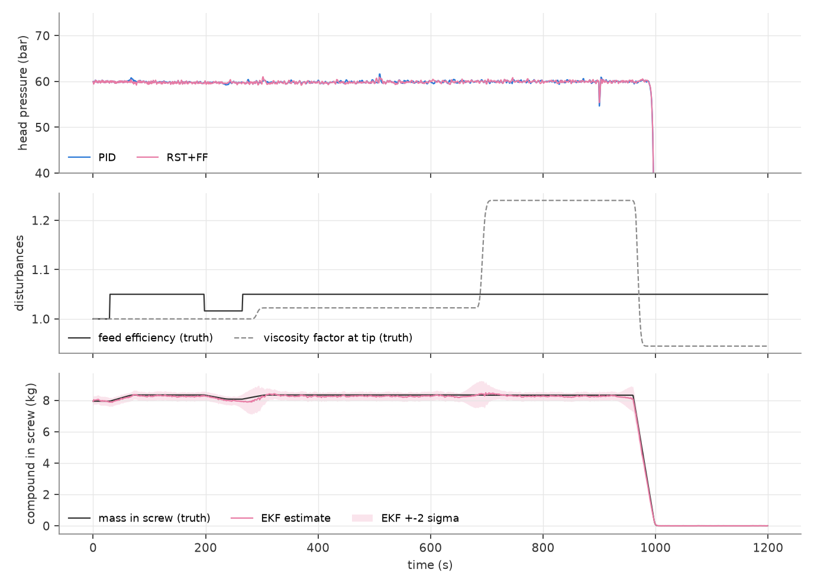
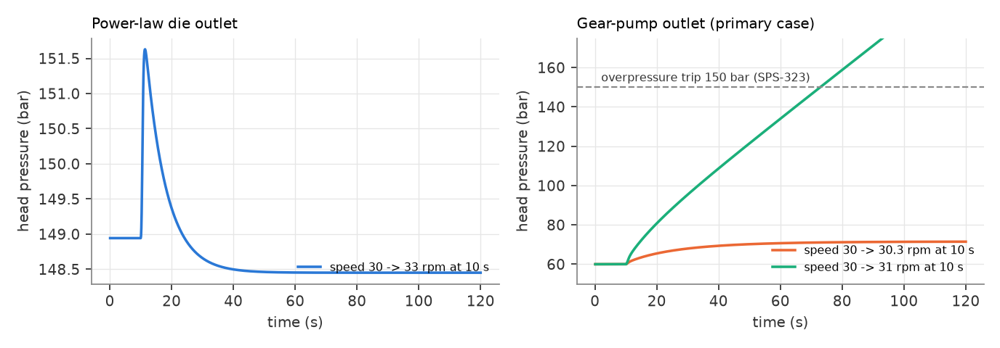
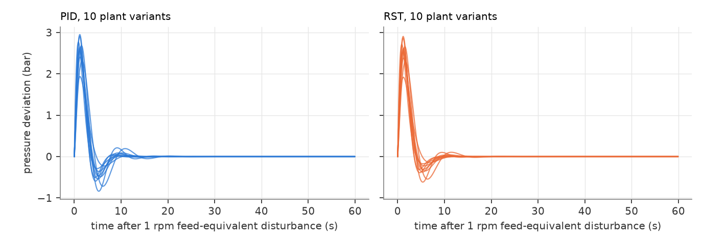
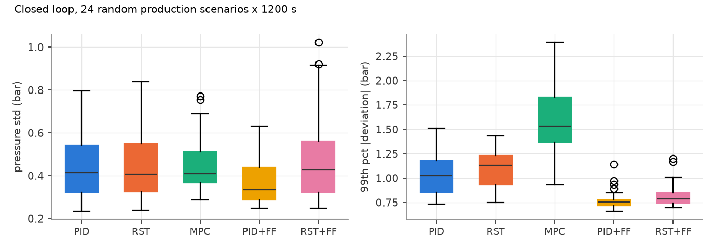
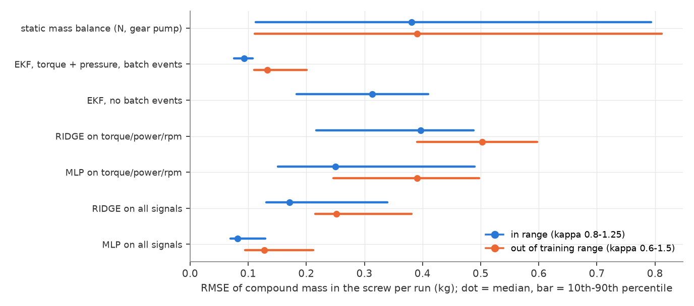
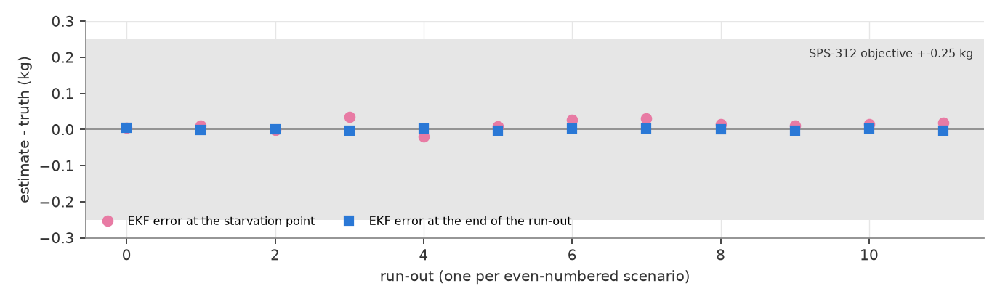
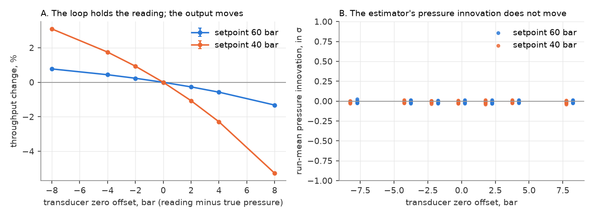
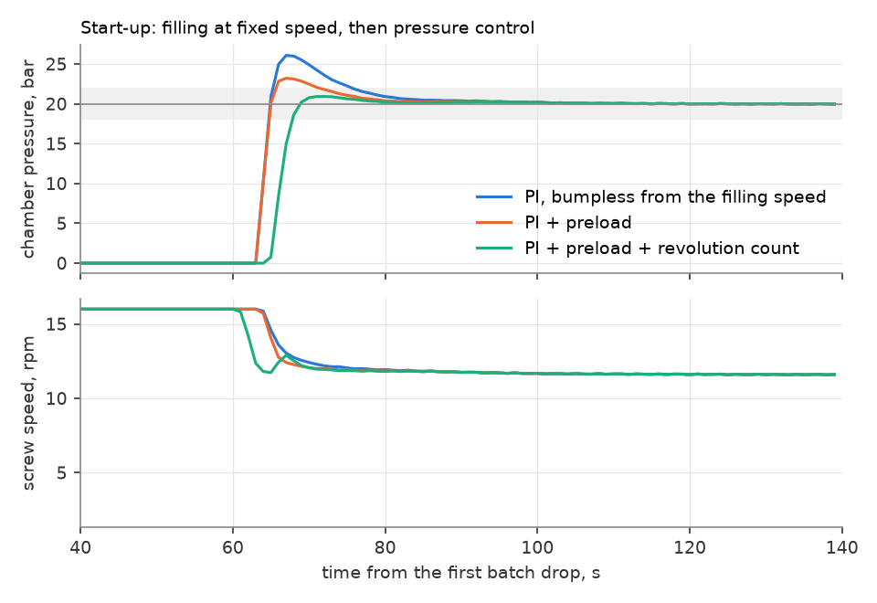

# extruder-pressure-fill-estimator

This project controls the pressure in front of the outlet pump of a **cold-feed rubber extruder** using a model, and it estimates **how much compound is left in the screw**. Both run as Siemens **SCL** blocks compiled in TIA Portal V18, and the work is laid out as a systems-engineering dossier that follows Wasson's spine.

- **Read first:** [DOSSIER.md](DOSSIER.md) ([PDF](docs/DOSSIER.pdf)). It covers the need, ConOps, modes, requirements, architecture, interfaces, budgets, M&S, FMEA, trade study and V&V plan.
- **Numbers:** [results/study.md](results/study.md), [results/aoa.md](results/aoa.md), [results/drift.md](results/drift.md) and [results/tsrd.md](results/tsrd.md).
- **Second plant case (v0.4.0):** a batch-fed twin-screw unit with a roller die, finding 7 below and [DOSSIER §8.5](DOSSIER.md).
- **Traceability and open items:** [TRACEABILITY.md](TRACEABILITY.md) and [OPEN_ITEMS.md](OPEN_ITEMS.md).
- **Data:** everything here is **simulated**. No data from a real line has been used. [DOSSIER §8.2](DOSSIER.md) lists which parameters are sourced and which are assumed.



## Findings

The numbers come from simulation: 24 random production scenarios of 1200 s each, run as
paired comparisons.

1. **What the pressure sits in front of matters.**
   - **Open die:** the speed-to-pressure gain is close to zero once viscous heating settles.
   - **Gear pump:** the plant is lag-dominated, with a gain of 6.7–110 bar/rpm across 40–80 bar.

   

2. **A robust RST does not regulate better than a robust PID** when both are tuned on the same
   10 plant variants under the same limits.
   - **Regulation:** 99th-percentile deviation 1.09 vs 1.05 bar.
   - **Where the RST is better:**
     - margin: Ms 1.46 vs 1.60;
     - 13 % less speed travel, better in all 24 runs;
     - zero setpoint overshoot.

   The 0.5 Hz flight ripple limits both controllers.

   

3. **The fill estimator is where the gain is.** A feed change reaches the pressure about 35 s
   after the torque has already seen it. Feedforward from the estimate cuts the
   99th-percentile deviation by 22–28 % (PID+FF better in 21 of 24 runs, RST+FF in 23 of 24).

   

4. **Compound left in the screw** (about 8 kg in the pumping section):

   | Estimator | RMSE in range | RMSE out of training range | Needs labels? |
   |---|---|---|---|
   | Physics EKF | 0.093 kg | 0.145 kg | no |
   | MLP on torque, power and rpm only | 0.29 kg | 0.38 kg | yes |

   - **Batch-change events:** without them the EKF error rises to 0.31 kg.
   - **Run-out:** at the point the gear pump starts to starve, the EKF is within ±0.04 kg in all
     12 run-outs. Version 0.1.0 was up to 0.62 kg off. Second-order transport fixed it.
   - **Uncertainty:** the reported ±2σ band holds the truth 99.9 % of the time.

   
   

5. **PLC fit.**
   - **Budget:** 1.46 ms per 100 ms cycle at datasheet instruction times, 4.4 ms with a 3× margin.
   - **Compile:** all SCL blocks compile in TIA Portal V18 with 0 errors and 0 warnings.
   - **Float32 checks:** the float32 runs match the Python references.
   - **A defect float32 exposed:** rounding the RST coefficients to float32 broke T(1) = R(1),
     which caused a pressure offset of several bar. The SCL now enforces that identity, and
     S(1) = 0, in its code structure.

6. **A zero drift of the pressure transducer cannot be seen in production, and the fill
   estimator does not flag it** (FMEA row F3; 12 paired scenarios per case,
   [results/drift.md](results/drift.md)).
   - **Consequence:** the loop holds the reading, so the true pressure sits at setpoint minus
     offset. A +8 bar offset costs 1.3 % of throughput at a 60 bar setpoint and 5.3 % at
     40 bar, where the assumed gear-pump fill curve is four times steeper.
   - **Detection:** the EKF explains the shifted reading with a different filled length. Its
     pressure innovation stays between −0.005 and −0.012 σ at every offset from −8 to +8 bar,
     the same as with no offset. Only 3 of 144 offset runs pass a threshold set for zero false
     alarms, fewer than chance would give. Revision B of the dossier named this innovation as
     the drift flag. That was wrong, and revision C corrects it.
   - **Side effect:** the offset biases the mass estimate, by +0.12 kg at +8 bar (60 bar
     setpoint) and +0.44 kg at +8 bar (40 bar setpoint).
   - **What does work:** a zero check at run-out. Once the screw is empty and the head has
     drained, the reading is the offset. In 48 simulated run-outs it was read to within
     0.10 bar, 105–112 s after the feed stopped, with no false capture. It assumes the head
     really drains to 0 bar, which only the plant can confirm.

   

7. **Second plant case: a batch-fed twin-screw unit with a roller die.** A public thesis
   on this control problem [T1] describes a different machine from the one above: whole
   batches drop from a mixer into twin screws that push the compound through a roller die,
   and a PI controller (Siemens PID_Compact) holds the pressure by the screw speed after a
   filling phase at fixed speed. `src/xtrude/tsrd.py` is a structural model of such a unit.
   Every parameter in it is assumed. Numbers: [results/tsrd.md](results/tsrd.md), 8 seeds.
   - **The start-up overshoot is a starting-value problem, not a loop-gain problem.** The
     pressure jumps when the chamber becomes full while the controller is still at the
     filling speed. A plain PI peaks at 25.6–27.3 bar on a 20 bar setpoint and settles in
     12–13 s.
   - **Two remembered numbers per recipe remove most of it.** With the steady speed of the
     last run as the starting value of the integrator, the peak is 23.1–23.7 bar and the
     settling 8 s. Adding the screw revolutions to full, so the speed is lowered just before
     the jump, gives 20.8–21.3 bar and 3–4 s. Both numbers are read from one earlier 1 s log.
     The control area (ISE) does not improve in every case: at the middle viscosity it
     is 1.28 s against 0.82 s for the plain PI.
   - **Scheduling the gain per recipe did not help.** The plant gain is proportional to the
     recipe viscosity (4.0–8.1 bar/rpm), but a first-order fit on one logged start-up sees
     only part of that spread (0.78–1.26 instead of 0.70–1.40), and the stiffest recipe got
     worse (peak 29.2 bar, settling 15 s).
   - **When the mixer is late, the plain PI repeats the start-up.** With a thin hopper reserve
     the screws run short, the PI raises the speed, and the pressure surges when material
     arrives: worst peaks of 56–96 bar, 14–17 % of the time outside ±10 %. (The model has no
     over-pressure trip; a real unit would stop first.) A feedforward from a material
     balance, with the PI held while the screws are short, gives worst peaks of 30–45 bar
     and 3–6 %. With errors in that balance (2–20 % on four parameters) it is 8–11 %.
   - **Remaining material (topic 3):** the conveying register follows the screw content to
     0.2 kg with exact parameters and 3.9 kg with errors; the drive torque alone gives
     10 kg. The total (hopper + screws + chamber) drifts with the throughput calibration:
     2 % error is 31 kg after eight batches, and the time to empty is then called 15 s
     early. The hopper has no signal of its own in this model, so the balance needs a
     reference once per batch (a level switch, or the moment the screws run short).

   

**What is not done:**
- the batch-fed unit is a structural model with assumed parameters; it has no SCL blocks and was not fitted to any log;
- the run-out zero check as an SCL block (it exists in Python only);
- PLCSIM run (S7-PLCSIM is not installed; see OPEN_ITEMS.md);
- execution time measured on a real CPU;
- any data from a real line.

The V&V plan is in [DOSSIER §11](DOSSIER.md).

## What is in the repo

| Path | Content |
|---|---|
| `src/xtrude/physics.py` | Screw pumping: power-law viscosity with temperature shift, drag/pressure flow with shape factors, power |
| `src/xtrude/plant.py` | Extruder simulator: partially filled screw, moving fill front, batches carried with the compound, compressible head, gear-pump or die outlet, drive, sensors |
| `src/xtrude/ident.py` | Technician test (±0.3 rpm, 2 min) and output-error identification |
| `src/xtrude/control.py` | PID, RST pole placement (Diophantine, observer anti-windup), DMC-type MPC, robustness analysis |
| `src/xtrude/design.py` | Robust tuning of PID and RST on 10 plant variants under the same constraints |
| `src/xtrude/estimator.py` | Screw-fill EKF (12 compartments + feed fill + consistency + filled length) and the feedforward speed |
| `src/xtrude/tsrd.py` | Second plant case: batch-fed twin-screw unit with a roller die (hopper, conveying screws, chamber, roller-die nip) |
| `src/xtrude/tsrd_sim.py` | Start-up sequence, recipe table, material balance and feedforward for that unit |
| `src/xtrude/zero_check.py` | Run-out zero check of the pressure transducer: two first-order filters and a timer, no sample buffer |
| `src/xtrude/learned.py` | Ridge and MLP estimators on torque/power/rpm (topic-3 literal) and on all signals |
| `src/xtrude/scl.py` | Translator that runs the SCL in Python with float32 Real and counts operations |
| `plc/FB_*.scl` | `FB_PressurePID`, `FB_PressureRST`, `FB_FillEKF`, `FB_PressureSupervisor` |
| `plc/tia/` | OB30 (100 ms), DBs, generated `FC_LoadParams` |
| `scripts/run_study.py` | Whole study → `results/`, `docs/img/` |
| `scripts/aoa.py` | Trade study → `results/aoa.md` |
| `scripts/drift_study.py` | Transducer zero-drift study (FMEA row F3) → `results/drift.md` |
| `scripts/tsrd_study.py` | Batch-fed unit: start-up, starvation, remaining material → `results/tsrd.md` |
| `scripts/tia_*.ps1` | TIA Openness build, OB30 conversion, screenshot |

## Run it

```bash
pip install -e .[test]
python -m pytest -q                 # plant, control, estimator, SCL equivalence
python scripts/run_study.py         # about an hour on a laptop; stages are cached
python scripts/aoa.py
python scripts/drift_study.py       # about 2 minutes
python scripts/tsrd_study.py        # about 3 minutes (--quick: 2 seeds, 40 s)
```

```powershell
powershell -ExecutionPolicy Bypass -File scripts\tia_build.ps1 -OutDir C:\TIA_xtrude
powershell -ExecutionPolicy Bypass -File scripts\tia_ob30.ps1  -Project <path.ap18>
powershell -ExecutionPolicy Bypass -File scripts\tia_screenshot.ps1 -Project <path.ap18> -Block FB_PressureRST -Out docs\img\tia_FB_PressureRST.png
```

## Licence

MIT, see [LICENSE](LICENSE).
